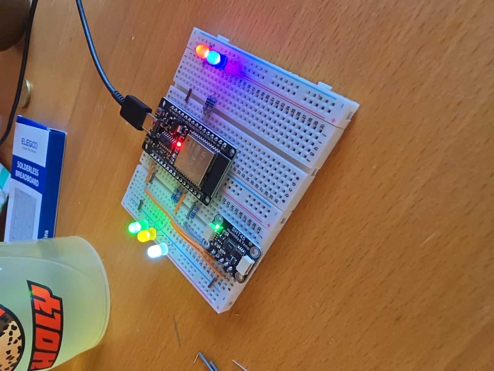
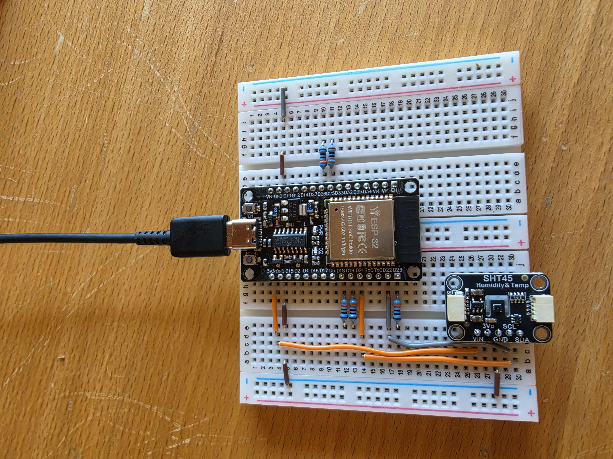
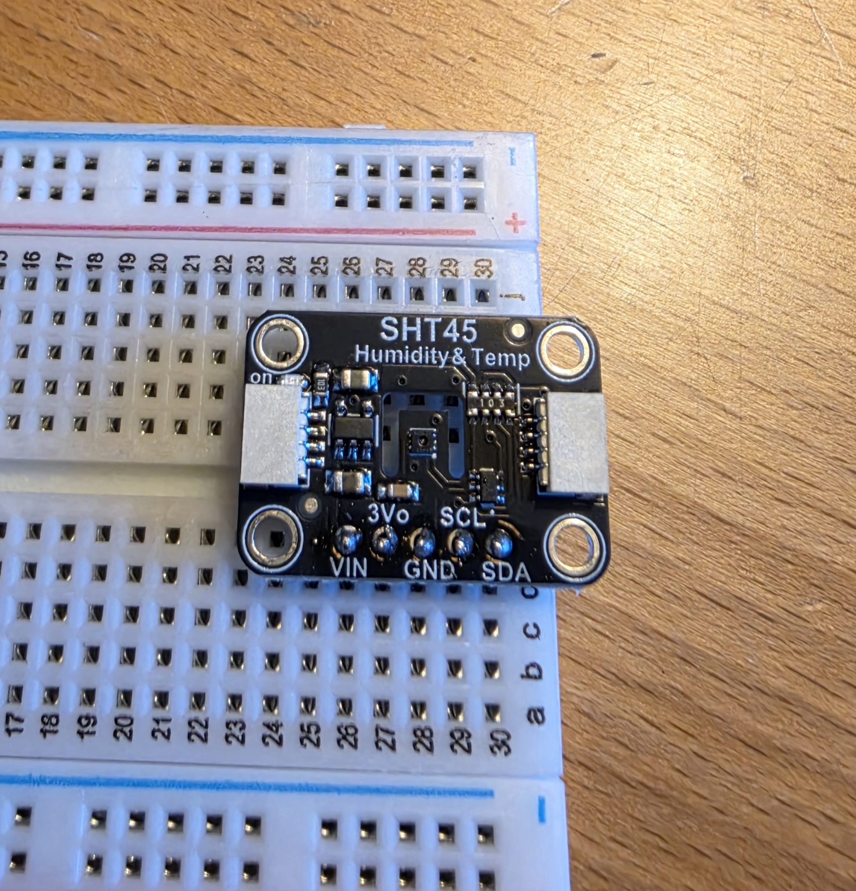
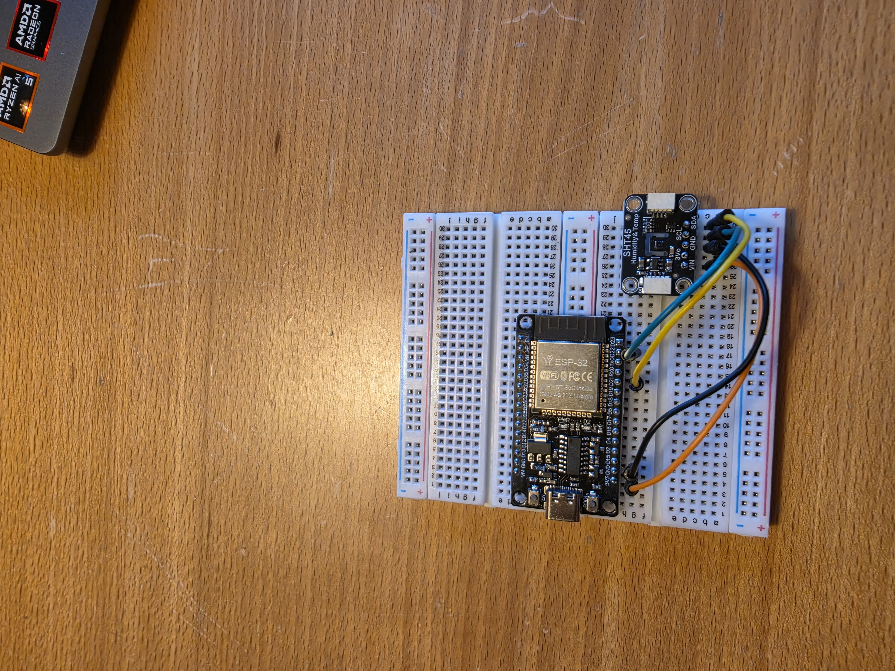
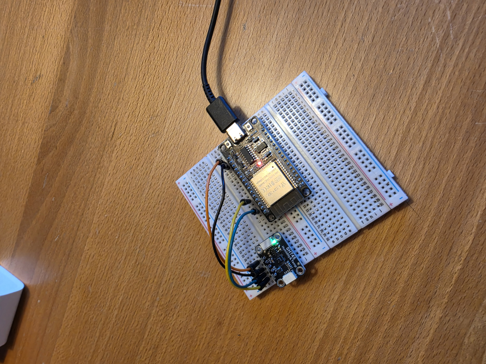
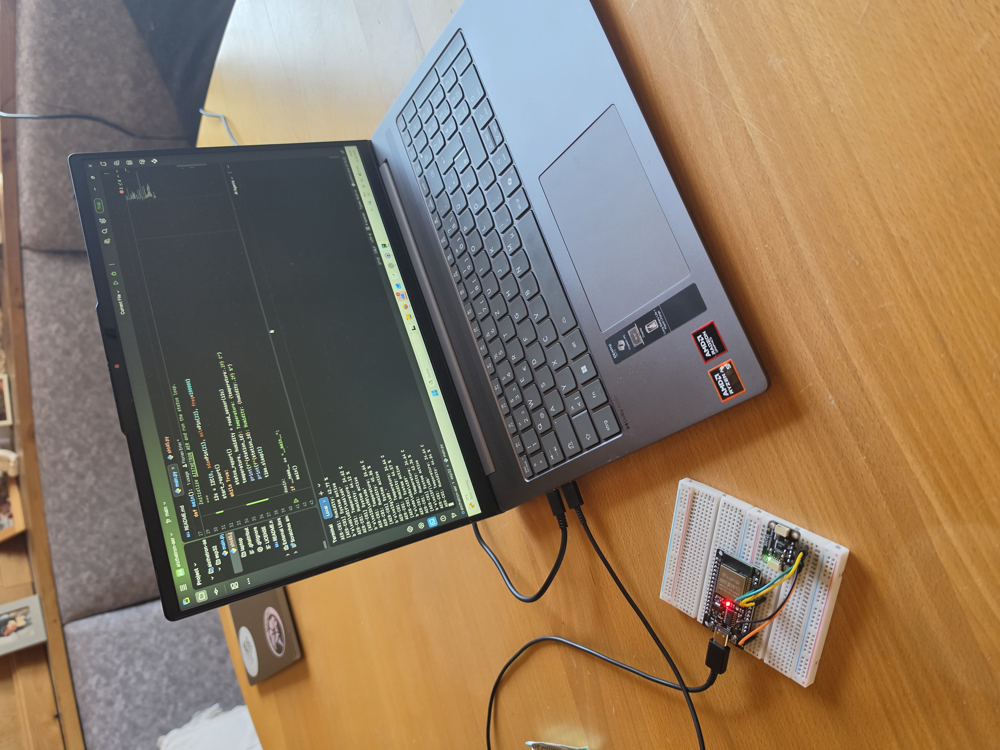
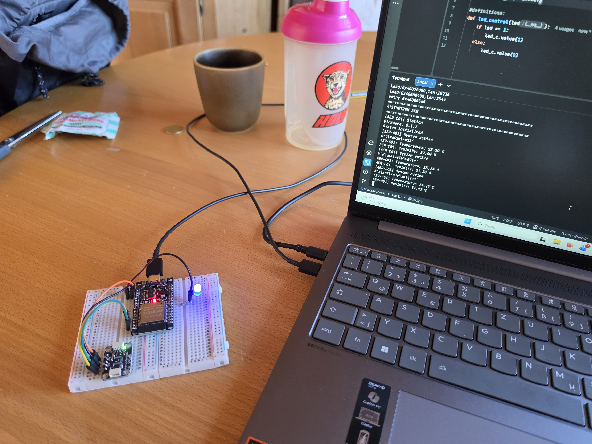
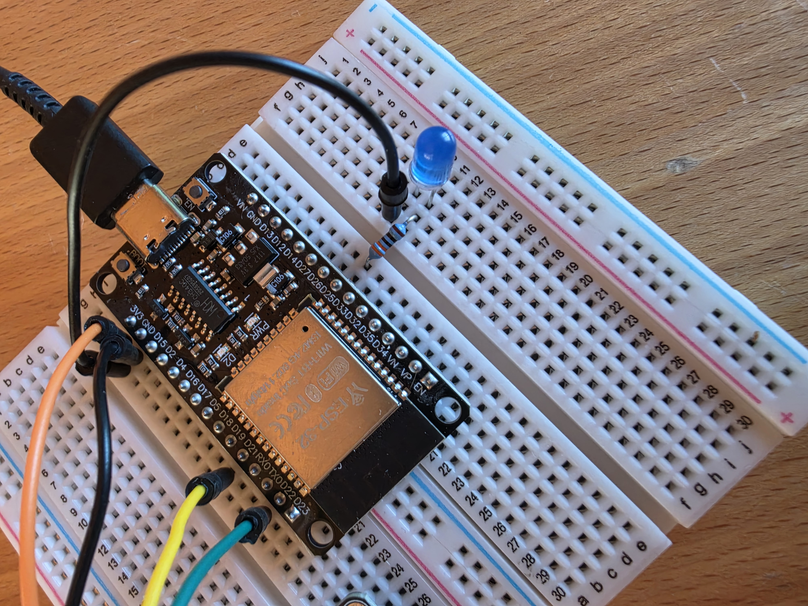

# AISTHETRON AER

*Making the Invisible Measurable.*

**AER-C01 · ESP32 + SHT45 · MicroPython · Firmware v0.1.5**

AISTHETRON AER is a hands-on environmental sensing project by Florian Erler. Its first station, **AER-C01**, measures temperature and relative humidity, validates every sensor response with CRC-8 and prints accepted readings to the serial console. Five LEDs show standby, measurement and fault states; two of them are reserved for future use.



*LED check with all five LEDs on. This is not a state used by the firmware.*

This is a development prototype: no calibration, no data logging, no wireless transmission.

## Hardware

| Component | Configuration |
| --- | --- |
| Controller | ESP32 development board (CH340 USB-to-serial) |
| Runtime | MicroPython 1.29.0 |
| Sensor | Sensirion SHT45 breakout, I²C address `0x44` |
| Bus | I²C0, SDA GPIO21, SCL GPIO22, 100 kHz |
| LEDs | Five LEDs, each with its own series resistor (330 Ω in the earlier single-LED build) |

### Wiring

| Connection | ESP32 | `led_control` index |
| --- | --- | --- |
| SHT45 VIN | 3V3 | – |
| SHT45 GND | GND | – |
| SHT45 SDA | GPIO21 | – |
| SHT45 SCL | GPIO22 | – |
| Green LED (reserved) | GPIO18 | `led[0]` |
| Yellow LED (standby) | GPIO19 | `led[1]` |
| White LED (reserved) | GPIO23 | `led[2]` |
| Blue LED (measurement) | GPIO25 | `led[3]` |
| Red LED (fault) | GPIO26 | `led[4]` |

Each LED: **GPIO → resistor → LED anode, cathode → GND**. Power the sensor from 3V3, not 5 V. GPIO numbers are ESP32 signal numbers, not breadboard rows.



## Firmware

| File | Purpose |
| --- | --- |
| `esp32/main.py` | Startup report, measurement loop, error handling |
| `esp32/sht45.py` | I²C measurement, CRC-8 check, conversion to °C and % |
| `esp32/led.py` | `led_control()` sets all five LEDs at once |

### LED control

`led_control` takes exactly five values, `0` or `1`, in the order green, yellow, white, blue, red. Anything else raises a `ValueError` before any LED is changed.

```python
led_control(0, 1, 0, 0, 0)  # standby: yellow
led_control(0, 0, 0, 1, 0)  # valid measurement: blue
led_control(0, 0, 0, 0, 1)  # CRC or I2C fault: red
```

### Behavior

Every five seconds the station reads the sensor:

| Situation | LED | Console |
| --- | --- | --- |
| Startup | yellow | startup report |
| Both CRC checks pass | blue | temperature and humidity |
| CRC check fails | red | `CRC check failed` |
| I²C error (`OSError`) | red | `I2C fault detected` |
| Loop stops (e.g. `Ctrl+C`) | yellow | – |

After a fault the next measurement is attempted automatically.

## Installation

Run in PowerShell from the repository root and replace `COM3` with your port:

```powershell
py -m pip install mpremote
py -m mpremote connect COM3 fs cp esp32/sht45.py :sht45.py
py -m mpremote connect COM3 fs cp esp32/led.py :led.py
py -m mpremote connect COM3 fs cp esp32/main.py :main.py
py -m mpremote connect COM3 repl
```

Press the board's reset button to start. To check the sensor connection in the REPL:

```python
from machine import I2C, Pin
i2c = I2C(0, sda=Pin(21), scl=Pin(22), freq=100000)
print(i2c.scan())  # expected: [68]
```

## Tests

The tests run on the computer with simulated hardware:

```powershell
py -B -m unittest discover -s tests -v
```

| File | Covers |
| --- | --- |
| `tests/test_sht45.py` | CRC calculation, conversion, corrupted packets |
| `tests/test_led.py` | LED states, rejection of invalid values |
| `tests/test_main.py` | Recovery after an I²C error |

## Build history

| | |
| --- | --- |
|  |  |
| Soldering the sensor headers | First prototype, unpowered |
|  |  |
| First power-up | First successful measurement, 16 October 2026 |
|  |  |
| Single-LED prototype (v0.1.2) | Original single-LED wiring |

## Roadmap

- Handle short or malformed sensor responses
- Hardware test of all LED states and fault recovery
- Start/Stop button
- Timestamped readings, storage and wireless transmission
- Comparison against a reference sensor

## Credits

Developed by **Florian Erler**. `calculate_crc()` in `sht45.py` was written by ChatGPT. ChatGPT also helped with the I²C recovery test and reviewed the LED driver, which the developer wrote.

Since 25 October 2026, **Claude** (Anthropic) has taken over from ChatGPT as the developer's coding tutor and accompanies the project with code reviews and guidance. The developer writes the code; `tests/test_led.py` was reworked by the developer under Claude's guidance. This condensed README was written by Claude.

## License

[MIT License](LICENSE) · © 2026 Florian Erler
